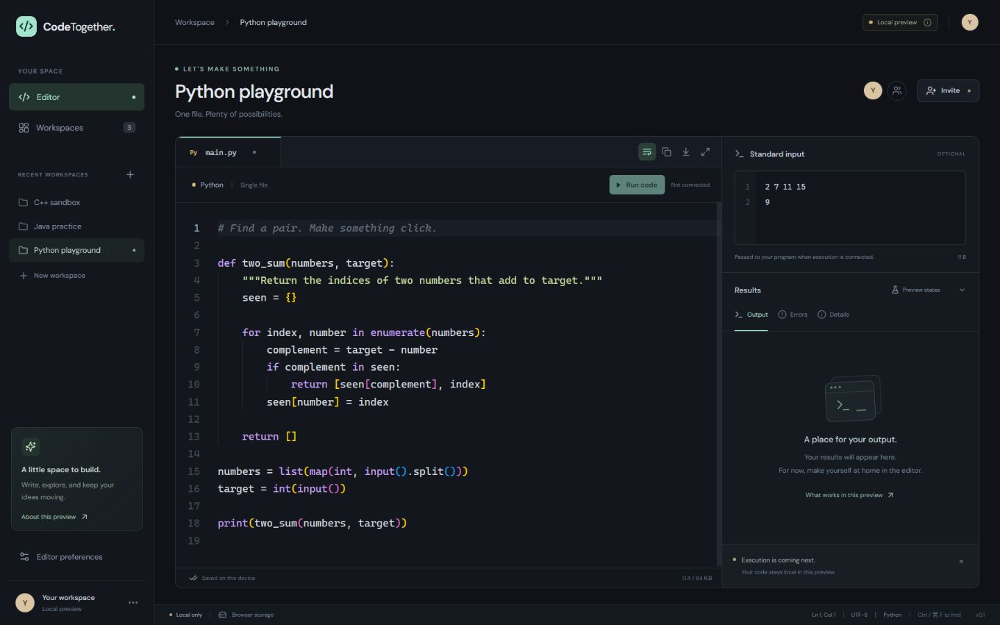
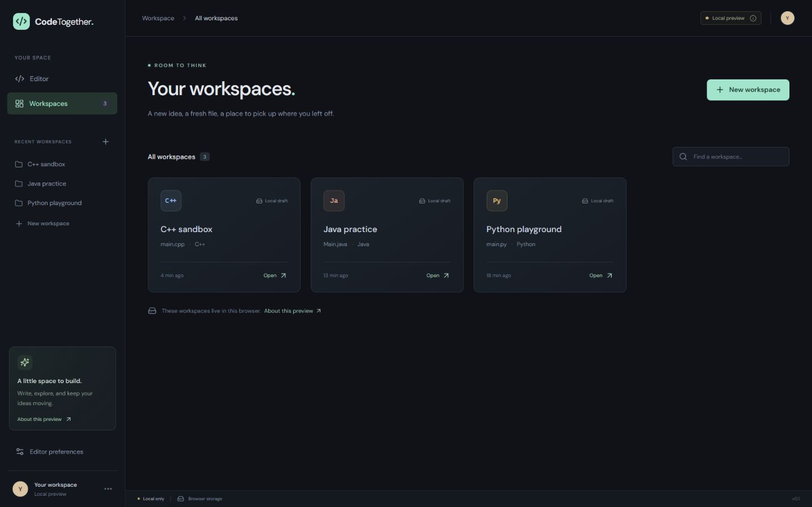
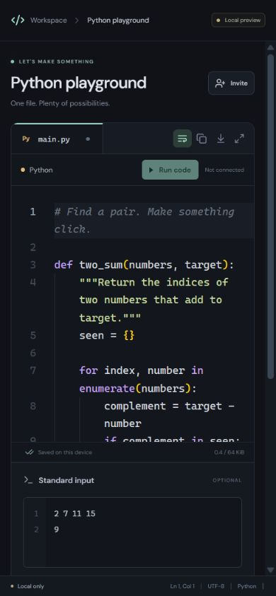

# CodeTogether

A web-based code-editor frontend for **Python, C++, and Java**, built as a B.Tech Computer Science major project.

> **Current status: local frontend prototype.** Editing, workspace management, and browser draft saving work. Authentication, multi-user synchronization, server persistence, and code execution are not connected. The **Run** button is disabled, and output examples are explicitly labelled UI previews.

## Preview



<details>
<summary>Workspace dashboard and narrow layout</summary>

### Workspace dashboard



### Narrow layout



</details>

## Features

| Area | Available features |
| --- | --- |
| Code editor | Monaco Editor, syntax highlighting, line numbers, indentation, find and replace, and local undo/redo |
| Local workspaces | Create, search, and switch workspaces with independent source code and standard input |
| Language profiles | Python with `main.py`, C++17 with `main.cpp`, and Java with `Main.java` |
| Draft saving | Browser storage, recovery after refresh, and visible saving/error states |
| Recovery safeguards | Validation of saved data; malformed drafts and detected changes from another tab pause saving until explicitly resolved |
| Input and result interface | Standard input; Output, Errors, and Details tabs; labelled example execution states |
| Source snapshots | Inspect the source and input captured for a UI example after the current editor changes |
| Preferences | Adjustable font size, word wrap, and focus mode |
| File actions | Copy source to the clipboard or download the active file |
| Interface | Dark theme, responsive layout, keyboard-operable result tabs, and dialogs with focus management |

Language profiles support **editing only**. No compiler or interpreter is connected. Participant and invitation controls do not connect other users.

## Technology stack

| Layer | Technology |
| --- | --- |
| User interface | React 19 and TypeScript |
| Build tooling | Vite 7 |
| Code editor | Monaco Editor with `@monaco-editor/react` |
| Styling | CSS with responsive layouts |
| Icons | Lucide React |
| Local persistence | Browser `localStorage` with validated draft recovery |
| Automated checks | Node.js test runner, TypeScript, and Vite production build |

Monaco and its editor worker are bundled with the application. The interface optionally requests DM Sans from Google Fonts and falls back to system fonts.

## Run locally

### Requirements

- **Node.js 22.12 or newer**. Node.js 24 was used for verification.
- **npm**, included with Node.js.
- A modern desktop browser.

Clone or download this repository. From its root directory, run:

```sh
npm ci
npm run dev
```

Open [http://127.0.0.1:5173/](http://127.0.0.1:5173/) in your browser. The development server binds to your local machine.

On Windows, if PowerShell blocks `npm.ps1`, use:

```powershell
npm.cmd ci
npm.cmd run dev
```

The frontend requires no database, Docker installation, OAuth credentials, or execution service.

### Try the prototype

1. Open the default Python playground.
2. Edit the starter source and standard input.
3. Create another workspace with C++ or Java.
4. Refresh to check browser draft recovery.
5. Use **Preview states** to inspect the sample result panels.
6. Adjust word wrap or font size, try focus mode, and copy or download a file.

The preview selector does not evaluate your program.

## Commands and verification

| Command | Purpose |
| --- | --- |
| `npm run dev` | Start the frontend development server |
| `npm test` | Run the draft validation/recovery tests |
| `npm run typecheck` | Check TypeScript |
| `npm run build` | Type-check and build into `apps/web/dist` |
| `npm run preview` | Serve the production build locally, normally on port 4173 |

The frontend was verified on **22 October 2026**: eight model tests passed, TypeScript and the production build passed, and manual browser checks covered editing, recovery, navigation, sample results, dialogs, and responsive layouts.

The build reports a large Monaco bundle warning. These checks do not establish production performance, complete browser/accessibility coverage, collaboration correctness, or execution security.

See [verification notes](docs/verification.md) for the checks and their limits.

## Project structure

```text
CodeTogether/
├── apps/
│   └── web/
│       ├── public/
│       ├── src/
│       │   ├── components/
│       │   │   ├── Dialog.tsx
│       │   │   └── WorkspaceEditor.tsx
│       │   ├── App.tsx
│       │   ├── main.tsx
│       │   ├── model.ts
│       │   └── styles.css
│       ├── package.json
│       └── vite.config.ts
├── docs/
│   ├── screenshots/
│   └── verification.md
├── tests/
│   └── model.test.mjs
├── .gitignore
├── package-lock.json
├── package.json
└── README.md
```

## Local data and limitations

- Drafts and preferences use the `codetogether.local.v1` browser storage key. Another browser, profile, or origin has separate data.
- Clearing site data removes drafts. Download important files as an independent copy.
- Use one active editing tab. External storage changes pause saving; the prototype does not merge edits across tabs or devices.
- Each source file is limited to **64 KiB** and standard input to **16 KiB**, measured in UTF-8 bytes.
- Up to **12 local workspaces** are supported.
- The layout adapts to narrow screens, but a desktop browser is the intended coding environment.
- Browser storage provides neither server persistence nor account authentication.
- No submitted code is executed.

## License

A project license has not been selected. This repository does not currently claim an MIT or other open-source license. Dependencies retain their respective licenses.
